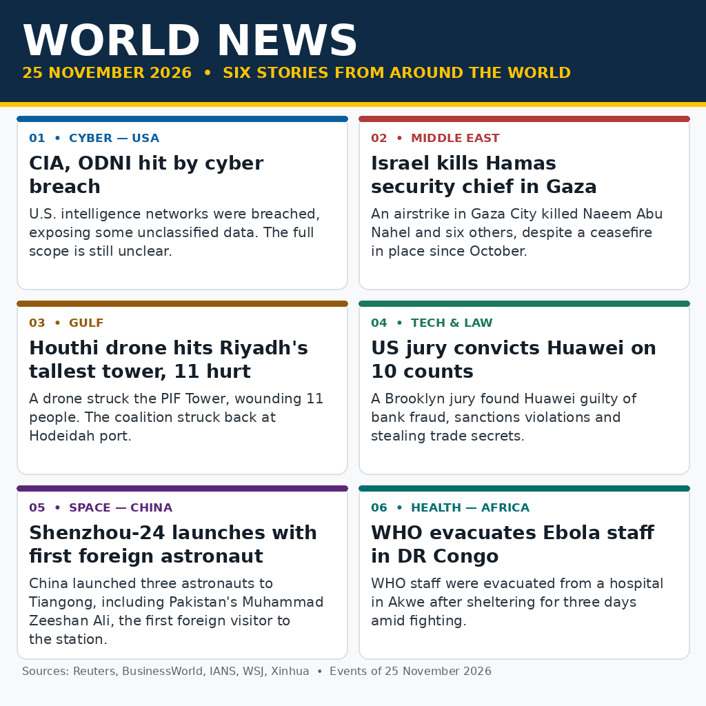

# World News — 25 November 2026

One image summing up the world's news of Wednesday, 25 November 2026.
Entry for the make.fun bounty `news-image-20261125`.



## The six stories

1. **CIA, ODNI hit by cyber breach** (USA / Cyber) — U.S. intelligence networks were breached, exposing some unclassified data. The full scope is still unclear.
2. **Israel kills Hamas security chief in Gaza** (Middle East) — An airstrike in Gaza City killed Naeem Abu Nahel and six others, despite a ceasefire in place since October.
3. **Houthi drone hits Riyadh's tallest tower, 11 hurt** (Gulf) — A drone struck the PIF Tower, wounding 11 people. The coalition struck back at Hodeidah port.
4. **US jury convicts Huawei on 10 counts** (Tech & Law) — A Brooklyn jury found Huawei guilty of bank fraud, sanctions violations and stealing trade secrets.
5. **Shenzhou-24 launches with first foreign astronaut** (Space / China) — China launched three astronauts to Tiangong, including Pakistan's Muhammad Zeeshan Ali, the first foreign visitor to the station.
6. **WHO evacuates Ebola staff in DR Congo** (Health / Africa) — WHO staff were evacuated from a hospital in Akwe after sheltering for three days amid fighting.

Sources: Reuters, BusinessWorld, IANS, WSJ, Xinhua. Events of 25 November 2026.

## How it runs

`main.ts` (Node 22, standard library only) copies `entry.png` to the output folder:

```sh
mkdir -p out && MAKEFUN_OUTPUT_DIR=out node main.ts
```

The output is `out/entry.png` — a 1024×1024 PNG, under 1 MiB.

## License

MIT — see `LICENSE`.
